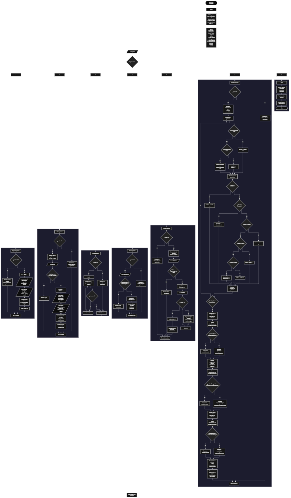

Este proyecto, llamado <b>atmósfera planetaria</b>, fue desarrollado en <b>java</b> como un ejercicio práctico para fortalecer la lógica de programación mediante la creación de un sistema de gestión de información atmosférica de diferentes planetas desde la consola. El programa cuenta con un menú principal de siete opciones que permite <b>registrar, editar, listar, buscar y eliminar planetas, además de consultar un resumen de la información almacenada</b>. Cada planeta almacena datos como el nombre, el tipo, la composición principal, la temperatura, la presión atmosférica, los porcentajes de oxígeno, nitrógeno y dióxido de carbono, la presencia de agua y el estado atmosférico, utilizando diez arreglos paralelos con una capacidad máxima de <b>10 planetas durante la ejecución</b>. Durante su desarrollo se aplicaron conceptos fundamentales de programación, como variables, arreglos, estructuras condicionales, ciclos repetitivos y estructuras de selección, además de procesos para buscar, modificar, eliminar y reorganizar registros. También se implementaron conteos y comparaciones para identificar las características más frecuentes y clasificar la información atmosférica de los planetas registrados. Este proyecto permite poner en práctica los conocimientos adquiridos en java y sirve como base para desarrollar sistemas de gestión más avanzados utilizando otros lenguajes y tecnologías.

<h2 align="center">⚙️ Funcionamiento del menú principal</h2>

### ➕ Registrar planeta

La opción <b>1) registrar planeta</b> permite almacenar un nuevo planeta en el sistema. Antes de realizar el registro, el programa comprueba que la cantidad de planetas almacenados sea menor que la capacidad del arreglo <b>nombresPlanetas.length</b>, utilizando la condición <b>total &gt;= nombresPlanetas.length</b> para determinar si se alcanzó el límite máximo de <b>10 planetas</b>. Si existe espacio disponible, genera un identificador mediante la expresión <b>total + 1</b> y solicita el <b>nombre del planeta, tipo de planeta, composición principal, temperatura, presión atmosférica, porcentaje de oxígeno, porcentaje de nitrógeno, porcentaje de dióxido de carbono, presencia de agua y estado atmosférico</b>. Los datos se almacenan en la posición correspondiente de sus respectivos arreglos utilizando la variable <b>total</b>. Finalmente, incrementa esta variable en uno y muestra el mensaje <b>"planeta registrado correctamente."</b>. Si se alcanza la capacidad máxima, presenta el mensaje <b>"no hay espacio para registrar mas planetas."</b>, impidiendo almacenar otro registro.

### ✏️ Editar planeta

La opción <b>2) editar planeta</b> permite modificar la información de un planeta registrado. Primero, el programa comprueba si existen planetas almacenados mediante la variable <b>total</b>. Si no hay registros, muestra el mensaje <b>"no existen planetas registrados."</b>. En caso contrario, presenta una lista con el ID, nombre, tipo, composición, temperatura, presión, oxígeno, nitrógeno, dióxido de carbono, presencia de agua y estado atmosférico de cada planeta. Después, solicita el identificador del planeta que se desea editar y comprueba que esté dentro del rango permitido mediante la condición <b>idEditar &gt;= 1 &amp;&amp; idEditar &lt;= total</b>. Si la selección es válida, utiliza la expresión <b>idEditar - 1</b> para obtener la posición correspondiente y solicita los nuevos datos del planeta, actualizando directamente los diez arreglos. Finalmente, presenta el mensaje <b>"planeta actualizado correctamente."</b>. Si el identificador seleccionado no corresponde a un planeta registrado, muestra el mensaje <b>"ID no encontrada."</b>.

### 📋 Listar planetas

La opción <b>3) listar planetas</b> permite visualizar todos los planetas registrados actualmente en el sistema. Antes de mostrar la información, el programa comprueba si la variable <b>total</b> es igual a cero. Si no existen registros, presenta el mensaje <b>"no existen planetas registrados."</b>. Si hay planetas disponibles, utiliza un ciclo <b>for</b> para recorrer los arreglos desde la primera posición hasta el número total de planetas registrados. Durante el recorrido, muestra el ID, nombre del planeta, tipo, composición principal, temperatura, presión atmosférica, porcentaje de oxígeno, porcentaje de nitrógeno, porcentaje de dióxido de carbono, presencia de agua y estado atmosférico. El identificador de cada registro se obtiene mediante la expresión <b>i + 1</b>. Esta función facilita consultar toda la información almacenada sin necesidad de buscar cada planeta individualmente.

### 🔎 Buscar planeta

La opción <b>4) buscar planeta</b> permite localizar un planeta mediante su identificador. Primero, el programa comprueba si existen planetas registrados. Si no hay información almacenada, muestra el mensaje <b>"no existen planetas registrados."</b>. En caso contrario, presenta el apartado de búsqueda y solicita el ID del planeta que se desea localizar. Después, comprueba que el identificador introducido esté dentro del rango permitido mediante la condición <b>idBusqueda &gt;= 1 &amp;&amp; idBusqueda &lt;= total</b>. Si el ID es válido, utiliza la expresión <b>idBusqueda - 1</b> para acceder directamente a la posición correspondiente de los diez arreglos y muestra toda la información del planeta encontrado. Si el identificador no corresponde a un registro existente, presenta el mensaje <b>"ID no encontrada."</b>. Esta búsqueda permite consultar un planeta específico sin necesidad de recorrer los arreglos para comparar sus datos.

### 🗑️ Eliminar planeta

La opción <b>5) eliminar planeta</b> permite eliminar un planeta registrado mediante su identificador dentro de la lista. Antes de comenzar, el programa comprueba que existan planetas almacenados. Si no hay registros, muestra el mensaje <b>"no existen planetas registrados."</b>. Si existen planetas disponibles, presenta una lista con el ID y todos los datos almacenados para facilitar su identificación. Después, solicita el identificador del planeta que se desea eliminar y verifica que esté dentro del rango válido mediante la condición <b>idEliminar &gt;= 1 &amp;&amp; idEliminar &lt;= total</b>. Si el planeta existe, utiliza la expresión <b>idEliminar - 1</b> para obtener su posición y comienza el proceso de eliminación. Para mantener los registros organizados, utiliza un ciclo <b>for</b> controlado por la variable <b>i</b>, que desplaza una posición hacia atrás los datos de los planetas posteriores en los diez arreglos. Posteriormente, disminuye la variable <b>total</b> en uno y muestra el mensaje <b>"planeta eliminado correctamente."</b>. Si el identificador seleccionado no corresponde a un planeta registrado, presenta el mensaje <b>"ID no encontrada."</b>.

### 📊 Mostrar resumen

La opción <b>6) mostrar resumen</b> permite consultar estadísticas generales de los planetas registrados y analizar diferentes características de sus atmósferas. Primero, el programa comprueba si existen registros almacenados. Si no hay planetas, muestra el mensaje <b>"no existen planetas registrados."</b>. En caso contrario, inicializa los contadores utilizados para clasificar la presencia de agua y los estados atmosféricos. Mediante un ciclo <b>for</b>, recorre los registros y utiliza estructuras condicionales <b>if, else if y else</b> para contar los planetas que tienen agua, los que no tienen agua y aquellos cuya información es desconocida. También clasifica los estados atmosféricos en <b>estable, inestable, densa, tenue, toxica y desconocida</b>. Posteriormente, realiza tres análisis mediante ciclos <b>for</b> anidados para identificar el <b>tipo de planeta, la composición principal y el estado atmosférico más frecuentes</b>. Estas comparaciones utilizan el método <b>equalsIgnoreCase()</b> para reconocer coincidencias sin distinguir entre mayúsculas y minúsculas. Finalmente, presenta el total de planetas registrados, las tres características más frecuentes y los contadores correspondientes a la presencia de agua y los estados atmosféricos. Cuando existen valores con la misma frecuencia máxima, conserva el primero que alcanza dicha cantidad.

### 🚪 Salir del menú principal

La opción <b>7) salir</b> está destinada a finalizar la ejecución del programa y muestra el mensaje <b>"gracias por utilizar Atmosfera Planetaria."</b>. El menú principal se encuentra dentro de una estructura repetitiva <b>do-while</b>, que mantiene el programa en funcionamiento mientras se realizan las operaciones disponibles. La condición de continuidad es <b>opcion != 7</b>, por lo que al seleccionar la opción 7 el ciclo termina correctamente. Finalmente, se utiliza <b>entrada.close()</b> para cerrar el objeto <b>Scanner</b> y finalizar la ejecución del programa.

<h2 align="center">🧠 Temas aplicados en el proyecto</h2>

### 📦 Variables

En este proyecto se utilizan variables para controlar la opción seleccionada en el menú, almacenar la cantidad de planetas registrados, generar los identificadores, seleccionar las posiciones de los arreglos, controlar los recorridos y realizar los diferentes conteos del resumen. También se utilizan variables para almacenar los resultados de los análisis de frecuencia y determinar qué tipo de planeta, composición y estado atmosférico aparecen con mayor frecuencia. Cada variable cumple una función específica dentro de las operaciones de gestión de información atmosférica.

🔢 **Opcion:** Almacena la opción seleccionada por el usuario en el menú principal.

📊 **Total:** Almacena la cantidad actual de planetas registrados.

🆔 **Id:** Almacena el identificador generado para el nuevo planeta durante el registro.

🔄 **I:** Funciona como contador en los ciclos `for` y permite recorrer los arreglos y seleccionar las posiciones de los planetas.

🔁 **J:** Funciona como contador interno de los ciclos `for` anidados utilizados para comparar las características de los planetas.

📝 **IdEditar:** Almacena el identificador del planeta que se desea editar.

🔎 **IdBusqueda:** Almacena el identificador del planeta que se desea buscar.

🗑️ **IdEliminar:** Almacena el identificador del planeta que se desea eliminar.

📍 **Posicion:** Almacena la posición correspondiente al identificador seleccionado mediante la operación de resta de uno.

💧 **AguaSi:** Cuenta los planetas cuya presencia de agua está registrada como "Si".

🚫 **AguaNo:** Cuenta los planetas cuya presencia de agua está registrada como "No".

❔ **AguaDesconocida:** Cuenta los planetas cuya presencia de agua contiene cualquier otro valor.

🌎 **Estable:** Cuenta las atmósferas clasificadas como estables.

⚠️ **Inestable:** Cuenta las atmósferas clasificadas como inestables.

🌫️ **Densa:** Cuenta las atmósferas clasificadas como densas.

💨 **Tenue:** Cuenta las atmósferas clasificadas como tenues.

☠️ **Toxica:** Cuenta las atmósferas clasificadas como tóxicas.

❔ **Desconocida:** Cuenta los estados atmosféricos que no coinciden con las categorías establecidas.

📈 **TipoMayor:** Almacena el tipo de planeta que presenta la mayor frecuencia.

📈 **ComposicionMayor:** Almacena la composición principal que presenta la mayor frecuencia.

📈 **EstadoMayor:** Almacena el estado atmosférico que presenta la mayor frecuencia.

🔢 **CantidadTipoMayor, CantidadComposicionMayor y CantidadEstadoMayor:** Almacenan las cantidades máximas encontradas durante los respectivos análisis de frecuencia.

### 🗃️ Arreglos

En este proyecto se utilizan diez arreglos relacionados con la información de cada planeta. Cada arreglo tiene una capacidad de <b>10 posiciones</b> y utiliza el mismo índice para representar los datos correspondientes a un mismo registro. Por ejemplo, la información de un planeta almacenado en la posición <b>0</b> se encuentra distribuida entre <b>nombresPlanetas[0], tiposPlanetas[0], composiciones[0], temperaturas[0], presiones[0], oxigenos[0], nitrogenos[0], dioxidosCarbono[0], presenciaAgua[0] y estadosAtmosfericos[0]</b>. Esta organización permite recorrer, buscar, modificar, mostrar y eliminar los planetas de manera ordenada.

🪐 **NombresPlanetas[10]:** Almacena los nombres de los planetas registrados.

🌎 **TiposPlanetas[10]:** Almacena los tipos correspondientes a cada planeta.

🧪 **Composiciones[10]:** Almacena las composiciones principales de las atmósferas planetarias.

🌡️ **Temperaturas[10]:** Almacena las temperaturas de los planetas.

📊 **Presiones[10]:** Almacena los valores de presión atmosférica.

💨 **Oxigenos[10]:** Almacena los porcentajes de oxígeno de cada planeta.

🌫️ **Nitrogenos[10]:** Almacena los porcentajes de nitrógeno de cada planeta.

🧪 **DioxidosCarbono[10]:** Almacena los porcentajes de dióxido de carbono de cada planeta.

💧 **PresenciaAgua[10]:** Almacena la información relacionada con la presencia de agua.

🌌 **EstadosAtmosfericos[10]:** Almacena los estados atmosféricos de los planetas registrados.

### 🔀 Estructuras condicionales

En este proyecto se utilizan las estructuras <b>if, else if y else</b> para comprobar diferentes condiciones durante las operaciones del sistema. Estas estructuras permiten verificar si existen planetas registrados antes de realizar determinadas operaciones, comprobar que haya espacio disponible antes de registrar un nuevo planeta, validar los identificadores utilizados para editar, buscar o eliminar registros y clasificar la presencia de agua y los estados atmosféricos durante la elaboración del resumen. También permiten determinar cuándo una característica presenta una frecuencia mayor que la registrada anteriormente. Estas condiciones hacen posible que el programa responda de manera diferente según la información almacenada y el resultado de cada comprobación.

### 🔄 Estructuras repetitivas

En este proyecto se utilizan los ciclos <b>do-while</b> y <b>for</b>. El ciclo <b>do-while</b> mantiene activo el menú principal y permite ejecutar las diferentes operaciones hasta que el usuario selecciona la opción 7. Por otro lado, los ciclos <b>for</b> permiten recorrer los arreglos para mostrar los planetas, presentar sus datos durante las operaciones de edición y eliminación, y acceder a la información almacenada. Durante la eliminación, también se utiliza un ciclo <b>for</b> para desplazar los datos de los planetas posteriores una posición hacia atrás. En el resumen, los ciclos <b>for</b> anidados permiten comparar los valores de los arreglos y determinar las características que aparecen con mayor frecuencia.

### 🎯 Estructura switch

El programa utiliza la estructura <b>switch</b> para evaluar el valor almacenado en la variable <b>opcion</b> y ejecutar el bloque de instrucciones correspondiente. Cada caso representa una operación específica del sistema: <b>registrar planeta, editar planeta, listar planetas, buscar planeta, eliminar planeta, mostrar resumen o salir</b>. También se utiliza el bloque <b>default</b> para mostrar el mensaje <b>"Opcion no valida."</b> cuando el usuario introduce un número que no coincide con ninguna de las opciones definidas en el menú principal. Esta estructura permite organizar las operaciones y facilitar la selección de las funcionalidades disponibles.

### 🔢 Dimensionamiento de arreglos

El programa utiliza la instrucción <b>new String[10]</b> para establecer la capacidad de los diez arreglos que almacenan la información de los planetas. Cada arreglo dispone de <b>10 posiciones</b>, lo que permite administrar hasta diez planetas durante la ejecución. La cantidad de posiciones ocupadas se controla mediante la variable <b>total</b>, por lo que las operaciones recorren únicamente los registros comprendidos entre la primera posición y el total actual de planetas. Además, durante el registro se utiliza la propiedad <b>nombresPlanetas.length</b> para comprobar la capacidad máxima disponible antes de almacenar un nuevo planeta.

### 🔄 Reorganización de registros

Cuando se selecciona un planeta para eliminarlo, el programa utiliza un ciclo <b>for</b> que comienza en la posición seleccionada y llega hasta <b>total - 1</b>. En cada repetición, los datos de la posición siguiente se copian sobre la posición actual en los diez arreglos: <b>nombresPlanetas, tiposPlanetas, composiciones, temperaturas, presiones, oxigenos, nitrogenos, dioxidosCarbono, presenciaAgua y estadosAtmosfericos</b>. Después, la variable <b>total</b> disminuye en uno. De esta manera, los planetas posteriores ocupan las posiciones disponibles y los registros activos permanecen organizados sin espacios intermedios. La última posición no se limpia explícitamente, pero deja de formar parte de los registros activos porque el contador total disminuye.

<h2 align="center">¿Cómo se implementaron las operaciones crud en el proyecto?</h2>

Las operaciones <b>crud</b> se implementaron mediante las opciones del menú principal, permitiendo administrar la información atmosférica de los planetas registrados. La operación <b>crear</b> corresponde a <b>registrar planeta</b>, donde se introducen los diez datos de un nuevo registro; <b>leer</b> se realiza mediante las opciones <b>listar planetas, buscar planeta y mostrar resumen</b>, que permiten consultar los registros y analizar sus características; <b>actualizar</b> corresponde a <b>editar planeta</b>, donde se modifican los datos de un planeta registrado; y <b>eliminar</b> se realiza mediante la opción <b>eliminar planeta</b>, que reorganiza los datos de los arreglos después de retirar un registro. Estas operaciones utilizan variables, arreglos, condicionales y ciclos para gestionar la información almacenada temporalmente durante la ejecución del programa.

<h2 align="center">Diagrama de flujo del proyecto</h2>

<h2 align="center">🛡️ Validaciones del programa</h2>

### 📭 No existen planetas registrados

Esta validación se utiliza en las opciones de <b>editar, listar, buscar, eliminar y mostrar resumen</b>. El programa comprueba si la variable <b>total</b> es igual a <b>0</b> y, si no existen planetas registrados, muestra el mensaje <b>"No existen planetas registrados."</b>. Esta comprobación evita continuar con las operaciones que necesitan información almacenada cuando el sistema está vacío.

### ⚠️ Capacidad máxima alcanzada

Esta validación se utiliza durante el registro de nuevos planetas para controlar la capacidad máxima de los arreglos. El programa comprueba si <b>total &gt;= nombresPlanetas.length</b> antes de permitir agregar un nuevo registro. Si existe espacio disponible, solicita los diez datos del planeta y aumenta el contador <b>total</b> en uno. En caso contrario, muestra el mensaje <b>"No hay espacio para registrar mas planetas."</b>, impidiendo almacenar más registros mientras se mantenga la capacidad máxima de diez planetas.

### ❌ ID no encontrada

Esta validación se utiliza durante las operaciones de <b>editar, buscar y eliminar planetas</b>. El programa comprueba que el identificador introducido sea mayor o igual a <b>1</b> y menor o igual al valor de <b>total</b>. Si el ID se encuentra dentro del rango permitido, utiliza la expresión <b>ID - 1</b> para acceder a la posición correspondiente de los arreglos y realizar la operación solicitada. Si el identificador no corresponde a un planeta registrado, muestra el mensaje <b>"ID no encontrada."</b>. Esta comprobación evita modificar, buscar o eliminar posiciones que no corresponden a registros activos.

### 🔢 Opción inválida

La estructura <b>switch</b> incluye el bloque <b>default</b>, que muestra el mensaje <b>"Opcion no valida."</b> cuando el usuario introduce un número que no corresponde a ninguna de las siete opciones definidas en el menú principal. Esta comprobación permite informar al usuario cuando selecciona una operación que no está disponible en el sistema.

### 🔍 Comparación de información

Durante la elaboración del resumen, el programa utiliza el método <b>equalsIgnoreCase()</b> para comparar la presencia de agua, los estados atmosféricos, los tipos de planetas y las composiciones principales sin distinguir entre mayúsculas y minúsculas. Esto permite clasificar y contar valores que representan la misma información aunque hayan sido escritos utilizando diferentes combinaciones de letras mayúsculas y minúsculas. En los análisis de frecuencia, también se comprueba si la cantidad encontrada es mayor que la cantidad máxima almacenada para actualizar el resultado correspondiente.

### ⚠️ Entradas y datos no validados

El programa solicita los datos de cada planeta mediante <b>nextLine()</b> y almacena todos los campos como cadenas de texto. Sin embargo, no incorpora comprobaciones específicas para verificar que la temperatura, la presión atmosférica y los porcentajes introducidos tengan un formato numérico válido, ni comprueba que los campos contengan información o que los valores correspondan a categorías determinadas. Además, las opciones y los identificadores se capturan mediante <b>nextInt()</b>, por lo que una entrada que no sea numérica puede provocar un error durante la ejecución. Estas características corresponden a las limitaciones actuales del programa.

<h2 align="center">🎯 Objetivo del proyecto</h2>

El objetivo principal de este proyecto es fortalecer la <b>lógica de programación</b> mediante el desarrollo de un sistema de gestión de información atmosférica planetaria en <b>java</b>. A través de su construcción se busca aplicar los conocimientos adquiridos sobre variables, arreglos, estructuras condicionales, ciclos repetitivos y estructuras de selección, integrándolos para resolver un problema de manera organizada. Además, el proyecto permite comprender cómo registrar, consultar, modificar y eliminar información mediante arreglos paralelos, así como realizar conteos y análisis de frecuencia para obtener estadísticas sobre las características atmosféricas de diferentes planetas. De esta manera, se establece una base para desarrollar sistemas de gestión más completos utilizando otros lenguajes y tecnologías.

